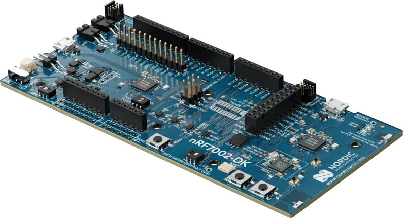
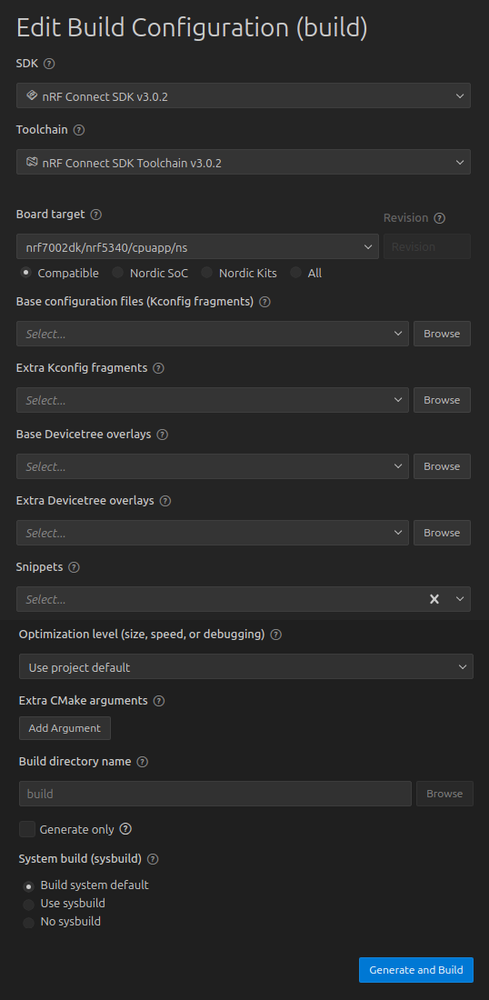
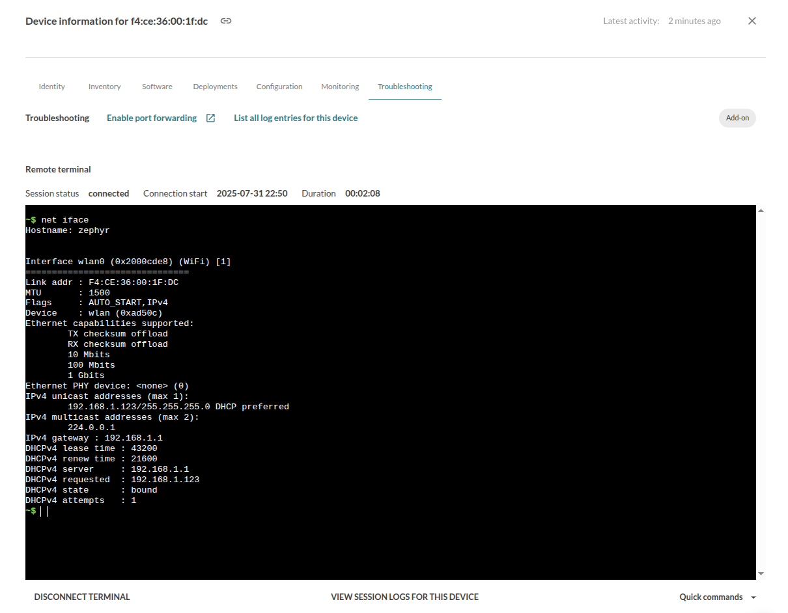

# mender-ncs-example

[](https://github.com/joelguittet/mender-ncs-example/actions)
[](https://github.com/joelguittet/mender-ncs-example/actions)
[](https://github.com/joelguittet/mender-ncs-example/issues)
[](https://github.com/joelguittet/mender-ncs-example/blob/master/LICENSE)

[](https://sonarcloud.io/dashboard?id=joelguittet_mender-ncs-example)
[](https://sonarcloud.io/dashboard?id=joelguittet_mender-ncs-example)
[](https://sonarcloud.io/dashboard?id=joelguittet_mender-ncs-example)
[](https://sonarcloud.io/dashboard?id=joelguittet_mender-ncs-example)
[](https://sonarcloud.io/dashboard?id=joelguittet_mender-ncs-example)

[](https://sonarcloud.io/dashboard?id=joelguittet_mender-ncs-example)
[](https://sonarcloud.io/dashboard?id=joelguittet_mender-ncs-example)
[](https://sonarcloud.io/dashboard?id=joelguittet_mender-ncs-example)

[Mender MCU client](https://github.com/joelguittet/mender-mcu-client) is an open source over-the-air (OTA) library updater for MCU devices. This demonstration project runs on nRF7002-DK hardware using nRF Connect SDK based on Zephyr RTOS.


## Getting started

This project is used with a [nRF7002-DK](https://www.nordicsemi.com/Products/Development-hardware/nRF7002-DK) evaluation board. No additional wiring is required.



The project is built using nRF Connect SDK v3.4.1 and Zephyr SDK v1.0.1. There is no other dependencies.

To start using Mender, we recommend that you begin with the Getting started section in [the Mender documentation](https://docs.mender.io).

To start using Zephyr, we recommend that you begin with the Getting started section in [the Zephyr documentation](https://docs.zephyrproject.org/latest/develop/getting_started/index.html). It is highly recommended to be familiar with Zephyr environment and tools to use this example.

To start using nRF Connect SDK, we recommend that you begin with the nRF Connect SDK [Get started page](https://www.nordicsemi.com/Products/Development-software/nRF-Connect-SDK/GetStarted). It is highly recommended to be familiar with nRF Connect SDK environment and tools to use this example.

### Initialize the project

Initiate a new workspace using the following commands. This will download the dependencies of the example application.

The projects depends on [cJSON](https://github.com/DaveGamble/cJSON) and [msgpack-c](https://github.com/msgpack/msgpack-c) (if troubleshoot add-on support is integrated, see below).

```
mkdir workspace-ncs
cd workspace-ncs
git clone https://github.com/joelguittet/mender-ncs-example
cd mender-ncs-example
git submodule update --init --recursive
python3 -m venv ../.venv
source ../.venv/bin/activate
pip install west
west init -l .
west update
west zephyr-export
west packages pip --install
west sdk install
```

### Configuration of the application

The example application should first be configured to set at least:
- `CONFIG_MENDER_SERVER_TENANT_TOKEN` to set the Tenant Token of your account on "https://hosted.mender.io" server.
- `CONFIG_EXAMPLE_WIFI_SSID` to set the SSID of the Access Point.
- `CONFIG_EXAMPLE_WIFI_PSK` to set the password of the network.

You may want to customize few interesting settings:
- `CONFIG_MENDER_SERVER_HOST` if using your own Mender server instance. Tenant Token is not required in this case.
- `CONFIG_MENDER_CLIENT_AUTHENTICATION_POLL_INTERVAL` is the interval to retry authentication on the mender server.
- `CONFIG_MENDER_CLIENT_UPDATE_POLL_INTERVAL` is the interval to check for new deployments.
- `CONFIG_MENDER_CLIENT_INVENTORY_REFRESH_INTERVAL` is the interval to publish inventory data.
- `CONFIG_MENDER_CLIENT_CONFIGURE_REFRESH_INTERVAL` is the interval to refresh device configuration.

Other settings are available in the Kconfig. You can also refer to the mender-mcu-client API and configuration keys.

### Building and flashing the application

The nRF7002-DK development kit depends on binary blobs. You can download them using the following commands.

```
west blobs fetch nrf_wifi
```

The application relies on mcuboot and requires to build a signed binary file to be flashed on the evaluation board. The binary file generated by the nRF Connect SDK contains TF-M and the application itself.

Use the following commands to build mcuboot and the application all together:

```
west build -b nrf7002dk/nrf5340/cpuapp/ns app
```

Finaly flash the board using the following command. Both mcuboot and the application will be flashed.

```
west flash
```

### Execution of the application

After flashing the application on the development board and opening a terminal to display the logs, you should be able to see the following:

```
[00:00:00.230,957] <inf> mender_ncs_example: Initialization of network interface
[00:00:00.234,191] <inf> wifi_supplicant: wpa_supplicant initialized
[00:00:00.292,816] <inf> mender_ncs_example: Initialization of certificate(s)
[00:00:00.302,673] <inf> mender_ncs_example: MAC address of the device 'f4:ce:36:00:1f:dc'
[00:00:00.313,446] <inf> mender_ncs_example: Running project 'mender-ncs-example' version '0.1.0'
[00:00:00.326,477] <inf> mender_ncs_example: Mender client version '0.13.2' initialized
[00:00:00.337,280] <inf> mender: WEST_TOPDIR/modules/lib/mender-mcu-client/platform/storage/generic/psa_its/src/mender-storage.c (228): Device configuration not available (-140)
[00:00:00.355,743] <inf> mender_ncs_example: Mender configure add-on registered
[00:00:00.365,661] <inf> mender_ncs_example: Mender inventory add-on registered
[00:00:00.375,518] <inf> mender_ncs_example: Device configuration retrieved
[00:00:00.408,935] <inf> mender: WEST_TOPDIR/modules/lib/mender-mcu-client/platform/storage/generic/psa_its/src/mender-storage.c (161): Deployment data not available (-140)
[00:00:00.426,849] <inf> mender_ncs_example: Mender client connect network
[00:00:00.436,309] <inf> mender_ncs_example: Connecting to the network
Connected
[00:00:09.872,131] <inf> mender_ncs_example: Got IPv4 event: 'NET_EVENT_IPV4_ADDR_ADD'
[00:00:09.882,629] <inf> mender_ncs_example: IPv4 address: 192.168.1.123
[00:00:09.891,876] <inf> mender_ncs_example: Lease time: 43200 seconds
[00:00:09.901,000] <inf> mender_ncs_example: Subnet: 255.255.255.0
[00:00:09.909,759] <inf> mender_ncs_example: Router: 192.168.1.1
[00:00:09.919,036] <inf> mender_ncs_example: Connected to the network
[00:00:10.729,370] <inf> mender: WEST_TOPDIR/modules/lib/mender-mcu-client/platform/net/zephyr/src/mender-net.c (165): Connected to the host 'hosted.mender.io:443' with IPv4 address '184.193
.122.130'
[00:00:11.111,846] <err> mender: WEST_TOPDIR/modules/lib/mender-mcu-client/core/src/mender-api.c (527): [401] Unauthorized: dev auth: unauthorized
[00:00:11.128,112] <inf> mender_ncs_example: Mender client authentication failed
[00:00:11.138,031] <inf> mender_ncs_example: Mender client released network
[00:00:21.147,705] <inf> mender_ncs_example: Disconnecting network
Disconnected
[00:00:21.175,262] <inf> mender_ncs_example: Got IPv4 event: 'NET_EVENT_IPV4_ADDR_DEL'
[00:00:21.209,197] <inf> mender_ncs_example: Disconnected of the network
```

Which means you now have generated authentication keys on the device. You now have to accept your device on the mender interface. Once it is accepted on the mender interface the following will be displayed:

```
[00:01:00.385,314] <inf> mender_ncs_example: Mender client connect network
[00:01:00.394,775] <inf> mender_ncs_example: Connecting to the network
Connected
[00:01:09.475,738] <inf> mender_ncs_example: Got IPv4 event: 'NET_EVENT_IPV4_ADDR_ADD'
[00:01:09.486,236] <inf> mender_ncs_example: IPv4 address: 192.168.1.123
[00:01:09.495,513] <inf> mender_ncs_example: Lease time: 43200 seconds
[00:01:09.504,638] <inf> mender_ncs_example: Subnet: 255.255.255.0
[00:01:09.513,397] <inf> mender_ncs_example: Router: 192.168.1.1
[00:01:09.522,674] <inf> mender_ncs_example: Connected to the network
[00:01:10.345,794] <inf> mender: WEST_TOPDIR/modules/lib/mender-mcu-client/platform/net/zephyr/src/mender-net.c (165): Connected to the host 'hosted.mender.io:443' with IPv4 address '3.233.1
33.10'
[00:01:10.713,226] <inf> mender_ncs_example: Mender client authenticated
[00:01:10.722,747] <inf> mender: WEST_TOPDIR/modules/lib/mender-mcu-client/core/src/mender-client.c (939): Checking for deployment...
[00:01:11.515,960] <inf> mender: WEST_TOPDIR/modules/lib/mender-mcu-client/platform/net/zephyr/src/mender-net.c (165): Connected to the host 'hosted.mender.io:443' with IPv4 address '184.193
.122.130'
[00:01:11.928,192] <inf> mender: WEST_TOPDIR/modules/lib/mender-mcu-client/core/src/mender-client.c (947): No deployment available
[00:01:11.942,535] <inf> mender_ncs_example: Mender client released network
[00:01:11.952,148] <inf> mender_ncs_example: Mender client connect network
[00:01:11.961,608] <inf> mender_ncs_example: Connected to the network
[00:01:12.748,931] <inf> mender: WEST_TOPDIR/modules/lib/mender-mcu-client/platform/net/zephyr/src/mender-net.c (165): Connected to the host 'hosted.mender.io:443' with IPv4 address '3.233.1
33.10'
[00:01:13.056,396] <inf> mender_ncs_example: Mender client released network
[00:01:13.066,009] <inf> mender_ncs_example: Mender client connect network
[00:01:13.075,439] <inf> mender_ncs_example: Connected to the network
[00:01:13.855,590] <inf> mender: WEST_TOPDIR/modules/lib/mender-mcu-client/platform/net/zephyr/src/mender-net.c (165): Connected to the host 'hosted.mender.io:443' with IPv4 address '184.193
.122.130'
[00:01:14.332,000] <inf> mender_ncs_example: Mender client released network
[00:01:24.341,796] <inf> mender_ncs_example: Disconnecting network
Disconnected
[00:01:24.369,354] <inf> mender_ncs_example: Got IPv4 event: 'NET_EVENT_IPV4_ADDR_DEL'
[00:01:24.403,167] <inf> mender_ncs_example: Disconnected of the network
```

Congratulation! Your device is connected to the mender server. Device type is `mender-nrf7002dk-ncs-example` and the current software version is displayed.

### Create a new deployment

First install [mender-artifact](https://docs.mender.io/downloads#mender-artifact) tool.

Change `VERSION` file to `VERSION_MAJOR=0` and `VERSION_MINOR=2`, rebuild the firmware using the same command already used.

```
west build -b nrf7002dk/nrf5340/cpuapp/ns app
```

Then create a new artifact using the following command line:

```
mender-artifact write rootfs-image --compression none --compatible-types mender-nrf7002dk-ncs-example --artifact-name mender-nrf7002dk-ncs-example-v0.2.0 --output-path build/app/zephyr/mender-nrf7002dk-ncs-example-v0.2.0.mender --file build/app/zephyr/zephyr.signed.bin
```

Upload the artifact `mender-nrf7002dk-ncs-example-v0.2.0.mender` to the mender server and create a new deployment.

The device checks for the new deployment, downloads the artifact and installs it on the update partition. Then it reboots to apply the update:

```
[00:04:10.722,686] <inf> mender_ncs_example: Mender client connect network
[00:04:10.732,116] <inf> mender_ncs_example: Connecting to the network
Connected
[00:04:20.815,429] <inf> mender_ncs_example: Got IPv4 event: 'NET_EVENT_IPV4_ADDR_ADD'
[00:04:20.825,927] <inf> mender_ncs_example: IPv4 address: 192.168.1.123
[00:04:20.835,174] <inf> mender_ncs_example: Lease time: 43200 seconds
[00:04:20.844,299] <inf> mender_ncs_example: Subnet: 255.255.255.0
[00:04:20.853,027] <inf> mender_ncs_example: Router: 192.168.1.1
[00:04:20.862,304] <inf> mender_ncs_example: Connected to the network
[00:04:21.649,047] <inf> mender: WEST_TOPDIR/modules/lib/mender-mcu-client/platform/net/zephyr/src/mender-net.c (165): Connected to the host 'hosted.mender.io:443' with IPv4 address '3.233.1
33.10'
[00:04:22.050,537] <inf> mender_ncs_example: Mender client released network
[00:04:22.060,119] <inf> mender_ncs_example: Mender client connect network
[00:04:22.069,580] <inf> mender_ncs_example: Connected to the network
[00:04:22.078,643] <inf> mender: WEST_TOPDIR/modules/lib/mender-mcu-client/core/src/mender-client.c (939): Checking for deployment...
[00:04:22.837,432] <inf> mender: WEST_TOPDIR/modules/lib/mender-mcu-client/platform/net/zephyr/src/mender-net.c (165): Connected to the host 'hosted.mender.io:443' with IPv4 address '184.193
.122.130'
[00:04:23.521,301] <inf> mender: WEST_TOPDIR/modules/lib/mender-mcu-client/core/src/mender-client.c (966): Downloading deployment artifact with id '9ffaf5eb-d789-4622-bc13-7b2dcb930bc3', art
ifact name 'mender-nrf7002dk-ncs-example-v0.2.0' and uri 'https://hosted-mender-artifacts.s3.amazonaws.com/6370b06a7f0deaedb279fb6a/5465e851-8fae-4644-a39a-dfb64f14d82d?X-A
[00:04:24.337,097] <inf> mender: WEST_TOPDIR/modules/lib/mender-mcu-client/platform/net/zephyr/src/mender-net.c (165): Connected to the host 'hosted.mender.io:443' with IPv4 address '3.233.1
33.10'
[00:04:24.850,189] <inf> mender_ncs_example: Deployment status is 'downloading'
[00:04:25.677,307] <inf> mender: WEST_TOPDIR/modules/lib/mender-mcu-client/platform/net/zephyr/src/mender-net.c (165): Connected to the host 'hosted-mender-artifacts.s3.amazonaws.com:443' wi
th IPv4 address '52.217.171.58'
[00:04:27.490,203] <inf> mender: WEST_TOPDIR/modules/lib/mender-mcu-client/core/src/mender-artifact.c (374): Artifact has valid version
[00:04:27.510,253] <inf> mender: WEST_TOPDIR/modules/lib/mender-mcu-client/platform/flash/zephyr/dfu_target/src/mender-flash.c (48): Start flashing artifact 'zephyr.signed.bin' with size 799
344
[00:05:55.870,605] <inf> mender: WEST_TOPDIR/modules/lib/mender-mcu-client/core/src/mender-client.c (979): Download done, installing artifact
[00:05:56.689,300] <inf> mender: WEST_TOPDIR/modules/lib/mender-mcu-client/platform/net/zephyr/src/mender-net.c (165): Connected to the host 'hosted.mender.io:443' with IPv4 address '3.233.1
33.10'
[00:05:57.215,484] <inf> mender_ncs_example: Deployment status is 'installing'
[00:05:57.226,318] <inf> dfu_target_mcuboot: MCUBoot image-0 upgrade scheduled. Reset device to apply
[00:05:58.112,274] <inf> mender: WEST_TOPDIR/modules/lib/mender-mcu-client/platform/net/zephyr/src/mender-net.c (165): Connected to the host 'hosted.mender.io:443' with IPv4 address '184.193
.122.130'
[00:05:58.648,986] <inf> mender_ncs_example: Deployment status is 'rebooting'
[00:05:58.659,088] <inf> mender_ncs_example: Mender client released network
[00:05:58.668,670] <inf> mender_ncs_example: Mender client connect network
[00:05:58.678,100] <inf> mender_ncs_example: Connected to the network
[00:05:59.434,478] <inf> mender: WEST_TOPDIR/modules/lib/mender-mcu-client/platform/net/zephyr/src/mender-net.c (165): Connected to the host 'hosted.mender.io:443' with IPv4 address '3.233.1
33.10'
[00:05:59.861,877] <inf> mender_ncs_example: Mender client released network
[00:06:09.871,673] <inf> mender_ncs_example: Disconnecting network
Disconnected
[00:06:09.899,230] <inf> mender_ncs_example: Got IPv4 event: 'NET_EVENT_IPV4_ADDR_DEL'
[00:06:09.934,539] <inf> mender_ncs_example: Disconnected of the network
[00:06:19.945,068] <inf> mender_ncs_example: Restarting system
uart:~$ [00:00:00.251,586] <inf> spi_nor: mx25r6435f@0: 8 MiBy flash
*** Booting MCUboot v2.3.0-dev-8122be0de002 ***
*** Using nRF Connect SDK v3.4.1-b20f8619ba9a ***
*** Using Zephyr OS v4.4.2-33fa6a7aac6a ***
[00:00:00.272,369] <inf> mcuboot: Starting bootloader
[00:00:00.277,832] <inf> mcuboot: LCS-awareness disabled, skipping LCS check
[00:00:00.285,949] <inf> mcuboot: Primary image: magic=unset, swap_type=0x1, copy_done=0x3, image_ok=0x3
[00:00:00.296,081] <inf> mcuboot: Secondary image: magic=good, swap_type=0x2, copy_done=0x3, image_ok=0x3
[00:00:00.305,969] <inf> mcuboot: Boot source: none
[00:00:00.311,645] <inf> mcuboot: Image index: 0, Swap type: test
[00:00:01.590,270] <inf> mcuboot: Verifying RSA PSS with signature len: 256
[00:00:01.612,060] <inf> mcuboot: RSA signature verification successful
[00:00:01.619,140] <inf> mcuboot: Starting swap using move algorithm.
[00:01:25.841,888] <inf> mcuboot: Verifying RSA PSS with signature len: 256
[00:01:25.863,616] <inf> mcuboot: RSA signature verification successful
[00:01:25.870,635] <inf> mcuboot: Bootloader chainload address offset: 0x10000
[00:01:25.878,204] <inf> mcuboot: Image version: v0.2.0
�00:01:25.883,819] <inf> mcuboot: Jumping to the first image slot
*** Booting mender-ncs-example v0.2.0-54b62b58b8f2 ***
*** Using nRF Connect SDK v3.4.1-b20f8619ba9a ***
*** Using Zephyr OS v4.4.2-33fa6a7aac6a ***
[00:00:00.230,987] <inf> mender_ncs_example: Initialization of network interface
[00:00:00.234,222] <inf> wifi_supplicant: wpa_supplicant initialized
[00:00:00.292,877] <inf> mender_ncs_example: Initialization of certificate(s)
[00:00:00.302,734] <inf> mender_ncs_example: MAC address of the device 'f4:ce:36:00:1f:dc'
[00:00:00.313,537] <inf> mender_ncs_example: Running project 'mender-ncs-example' version '0.2.0'
[00:00:00.326,568] <inf> mender_ncs_example: Mender client version '0.13.2' initialized
[00:00:00.337,371] <inf> mender: WEST_TOPDIR/modules/lib/mender-mcu-client/platform/storage/generic/psa_its/src/mender-storage.c (228): Device configuration not available (-140)
[00:00:00.355,804] <inf> mender_ncs_example: Mender configure add-on registered
[00:00:00.365,722] <inf> mender_ncs_example: Mender inventory add-on registered
[00:00:00.375,579] <inf> mender_ncs_example: Device configuration retrieved
[00:00:00.409,210] <inf> mender_ncs_example: Mender client connect network
[00:00:00.418,670] <inf> mender_ncs_example: Connecting to the network
Connected
[00:00:11.858,398] <inf> mender_ncs_example: Got IPv4 event: 'NET_EVENT_IPV4_ADDR_ADD'
[00:00:11.868,896] <inf> mender_ncs_example: IPv4 address: 192.168.1.123
[00:00:11.878,143] <inf> mender_ncs_example: Lease time: 43200 seconds
[00:00:11.887,268] <inf> mender_ncs_example: Subnet: 255.255.255.0
[00:00:11.896,026] <inf> mender_ncs_example: Router: 192.168.1.1
[00:00:11.905,303] <inf> mender_ncs_example: Connected to the network
[00:00:12.743,652] <inf> mender: WEST_TOPDIR/modules/lib/mender-mcu-client/platform/net/zephyr/src/mender-net.c (165): Connected to the host 'hosted.mender.io:443' with IPv4 address '3.233.1
33.10'
[00:00:13.228,118] <inf> mender_ncs_example: Mender client authenticated
[00:00:13.237,640] <inf> mender: WEST_TOPDIR/modules/lib/mender-mcu-client/platform/flash/zephyr/dfu_target/src/mender-flash.c (155): Application has been mark valid and rollback canceled
[00:00:14.035,095] <inf> mender: WEST_TOPDIR/modules/lib/mender-mcu-client/platform/net/zephyr/src/mender-net.c (165): Connected to the host 'hosted.mender.io:443' with IPv4 address '3.233.1
33.10'
[00:00:14.451,354] <inf> mender_ncs_example: Deployment status is 'success'
[00:00:14.553,070] <inf> mender: WEST_TOPDIR/modules/lib/mender-mcu-client/core/src/mender-client.c (939): Checking for deployment...
[00:00:15.317,474] <inf> mender: WEST_TOPDIR/modules/lib/mender-mcu-client/platform/net/zephyr/src/mender-net.c (165): Connected to the host 'hosted.mender.io:443' with IPv4 address '184.193
.122.130'
[00:00:15.704,772] <inf> mender: WEST_TOPDIR/modules/lib/mender-mcu-client/core/src/mender-client.c (947): No deployment available
[00:00:15.719,024] <inf> mender_ncs_example: Mender client released network
[00:00:15.728,668] <inf> mender_ncs_example: Mender client connect network
[00:00:15.738,098] <inf> mender_ncs_example: Connected to the network
[00:00:16.524,078] <inf> mender: WEST_TOPDIR/modules/lib/mender-mcu-client/platform/net/zephyr/src/mender-net.c (165): Connected to the host 'hosted.mender.io:443' with IPv4 address '3.233.1
33.10'
[00:00:17.116,943] <inf> mender_ncs_example: Mender client released network
[00:00:17.126,708] <inf> mender_ncs_example: Mender client connect network
[00:00:17.136,138] <inf> mender_ncs_example: Connected to the network
[00:00:17.928,344] <inf> mender: WEST_TOPDIR/modules/lib/mender-mcu-client/platform/net/zephyr/src/mender-net.c (165): Connected to the host 'hosted.mender.io:443' with IPv4 address '184.193
.122.130'
[00:00:18.548,217] <inf> mender_ncs_example: Mender client released network
[00:00:28.558,044] <inf> mender_ncs_example: Disconnecting network
Disconnected
[00:00:28.585,601] <inf> mender_ncs_example: Got IPv4 event: 'NET_EVENT_IPV4_ADDR_DEL'
[00:00:28.619,537] <inf> mender_ncs_example: Disconnected of the network
```

Congratulation! You have updated the device. Mender server displays the success of the deployment.

### Failure or wanted rollback

In case of failure to connect and authenticate to the server the current example application performs a rollback to the previous release.
You can customize the behavior of the example application to add your own checks and perform the rollback in case the tests fail.

### Building using vscode nRF Connect SDK environment

As an alternative to using the command line, it is possible to build the application using vscode nRF Connect SDK environment.

Open the app in the vscode nRF Connect SDK environment and create a new build configuration. Select the SDK, the toolchain and the board target `nrf7002dk/nrf5340/cpuapp/ns`. Keep the other options empty (note you may want to create a Kconfig fragment to define your local configuration).



Build and flash mcuboot, TF-M and the application using `Build` and `Flash` buttons of the `Actions` panel in the nRF Connect SDK environment. 

### Using Device Troubleshoot add-on

The Device Troubleshoot add-on permits to display the Zephyr Shell on the Mender interface. Autocompletion and colors are available.



The Device Troubleshoot add-on also permits to upload/download files to/from the Mender server and to perform port forwarding. However, due to limited FLASH memory remaining on the nRF5340, these feature are disabled in the current example.

The Device Troubleshoot add-on feature are integrated using `troubleshoot.conf` Kconfig fragment, for example using the following command.

```
west build -b nrf7002dk/nrf5340/cpuapp/ns app -- -DEXTRA_CONF_FILE="troubleshoot.conf"
```

### Using an other mender instance

The communication with the server is done using HTTPS. To get it working, the Root CA that is providing the server certificate should be integrated and registered in the application (see `tls_credential_add` in the `src/main.c` file). Format of the expected Root CA certificate is DER.

In this example we are using the `https://hosted.mender.io` server with an Enterprise account. While checking the details of the server certificate in your browser, you will see that is is provided by Amazon Root CA 1. Thus the Amazon Root CA 1 certificate `AmazonRootCA1.cer` retrieved at `https://www.amazontrust.com/repository` is integrated in the application.

Using another instance you may need to integrate another Root CA certificate. Also note depending of the certificate properties you may need to activate additional cipher suites in the TF-M configuration. See below considerations when using trial mender instance for example.

### Using a trial mender instance

The trial mender instance which is available for free at `http://hosted.mender.io` to test mender feature requires to integrate the Google Trust Services Root R4 certificate together with Amazon Root CA 1 certificate. This is required because the artifacts are saved on a Cloudflare server instead of the Amazon S3 storage. This is achieved using the secondary root certificate support provided by the mender-mcu-client.

```
CONFIG_MENDER_NET_CA_CERTIFICATE_TAG_PRIMARY=1
CONFIG_MENDER_NET_CA_CERTIFICATE_TAG_SECONDARY=2
```

However, TF-M profile type 'small' has only symmetric cipher to keep the size of the binary small. Particularly, the support of ECDSA with SHA384 which is required to parse the Google Trust Services Root R4 certificate need to be added to the configuration. This is achieved using the following configurations.

```
CONFIG_PSA_WANT_ALG_ECDH=y
CONFIG_PSA_WANT_ALG_ECDSA=y
CONFIG_PSA_WANT_ECC_SECP_R1_384=y
```

Those configurations are also available using the Kconfig fragment `trial.conf` in the build configuration, using the following command.

```
west build -b nrf7002dk/nrf5340/cpuapp/ns app -- -DEXTRA_CONF_FILE="trial.conf"
```


## Testing

[Twister](https://docs.zephyrproject.org/latest/develop/test/twister.html) and [Pytest](https://docs.pytest.org/en/stable) are used in Github actions workflows to execute tests on real target.

For such purpose, Github action runner is installed on a Debian machine running the workflows. The Debian machine uses `ghcr.io/zephyrproject-rtos/ci` container which provides a good environment to build Zephyr RTOS projects in such context.

When testing is executed, a dedicated mender-server instance is used. mender-server certificate to allow device and tests connecting to the server are provided. mender-server username and password are provided throw the Github Actions secrets.

The Debian machine has a local configuration `local.conf` file used to build the firmware which contains the following settings:

```
CONFIG_MENDER_SERVER_HOST="https://docker.mender.io"
CONFIG_MENDER_SERVER_TENANT_TOKEN=""
CONFIG_EXAMPLE_USE_CUSTOM_CERTIFICATE=y
CONFIG_EXAMPLE_CERTIFICATE_PATH="/__w/mender-ncs-example/mender-ncs-example/mender.der"
CONFIG_EXAMPLE_WIFI_SSID="<ssid of local network>"
CONFIG_EXAMPLE_WIFI_PSK="<psk of local network>"
```

The Debian machine has also a `map.yml` file to provide board settings for twister to run testing.

Tests cover device registration, inventory, configuration, troubleshooting shell, firmware update and decomissioning.

Tests are executed for each pull-request opened on the repository. Results are reported in the pull-request.

The workflows and test files can be reused for your own projects.


## License

Copyright joelguittet and mender-mcu-client contributors

Licensed under the Apache License, Version 2.0 (the "License");
you may not use this file except in compliance with the License.
You may obtain a copy of the License at

    http://www.apache.org/licenses/LICENSE-2.0

Unless required by applicable law or agreed to in writing, software
distributed under the License is distributed on an "AS IS" BASIS,
WITHOUT WARRANTIES OR CONDITIONS OF ANY KIND, either express or implied.
See the License for the specific language governing permissions and
limitations under the License.
